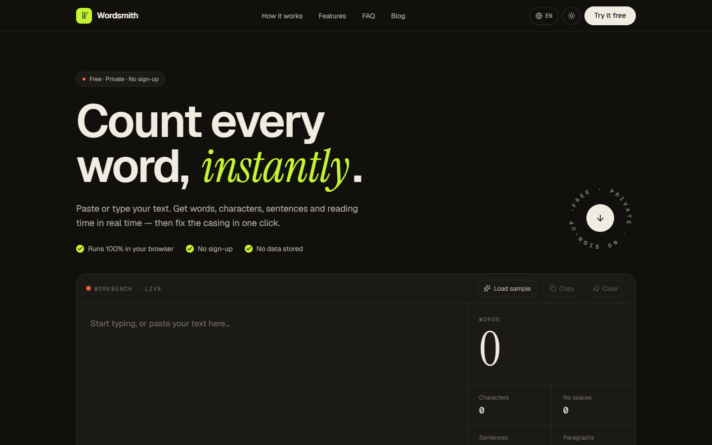
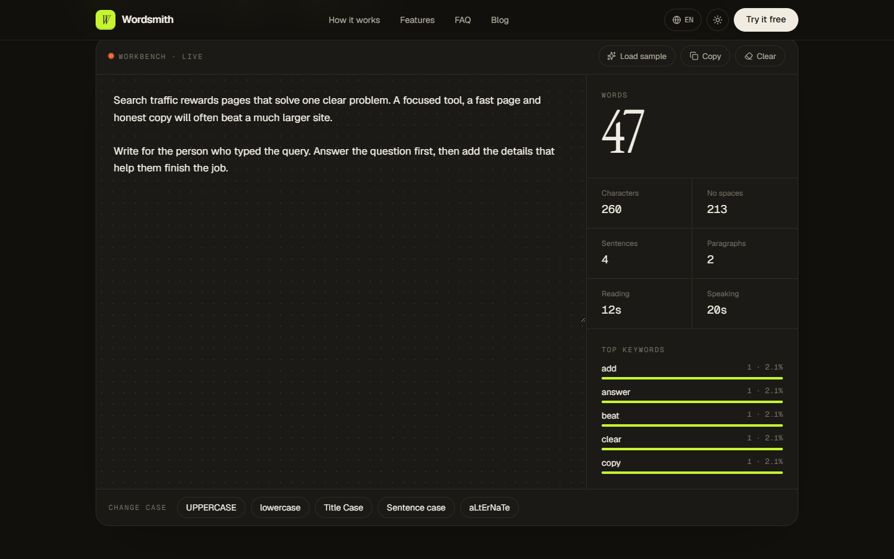
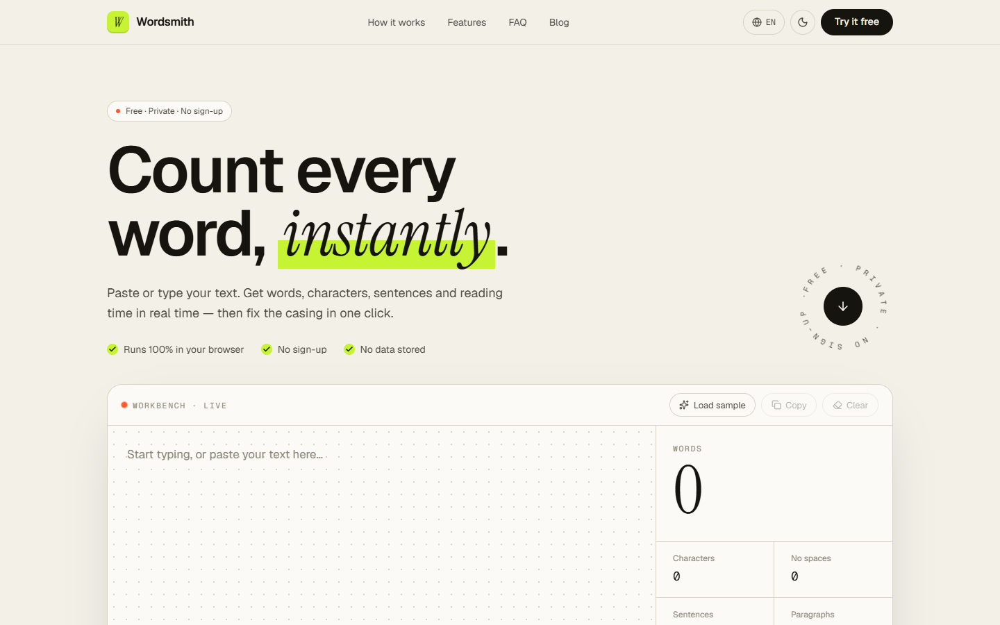
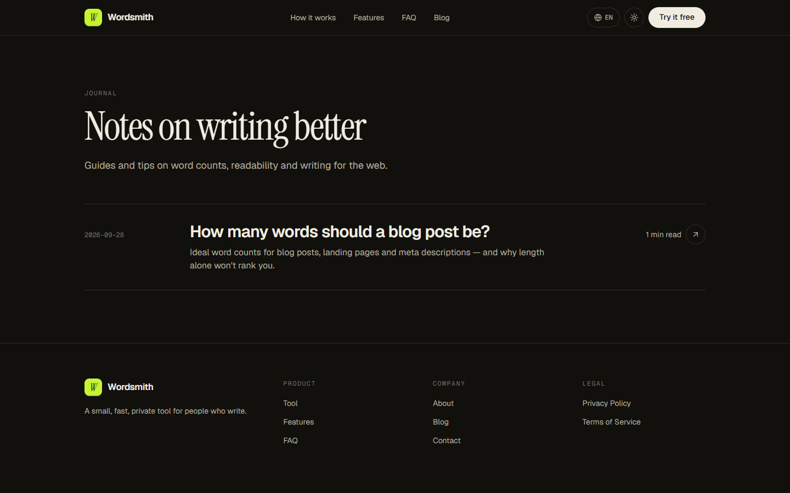
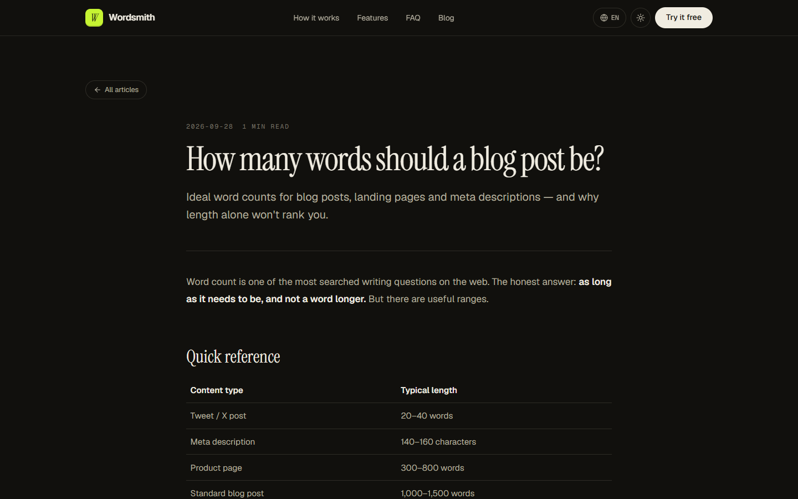
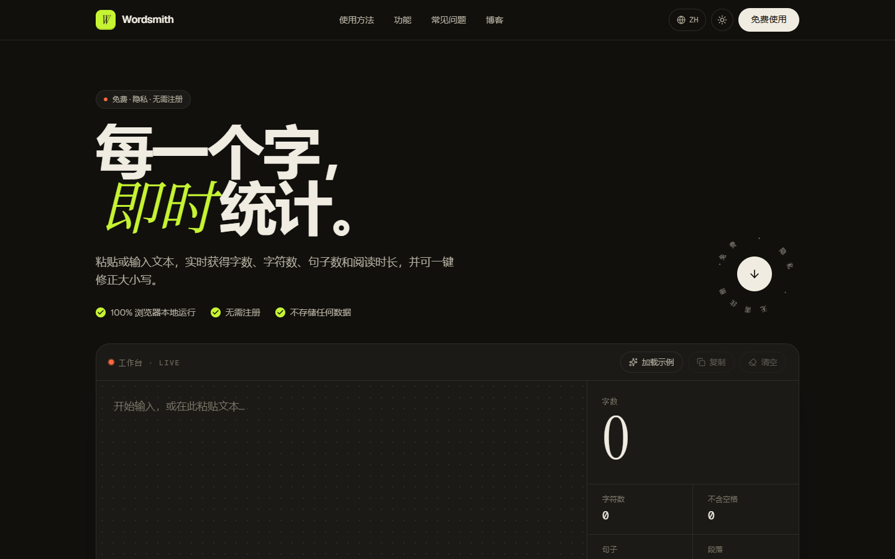
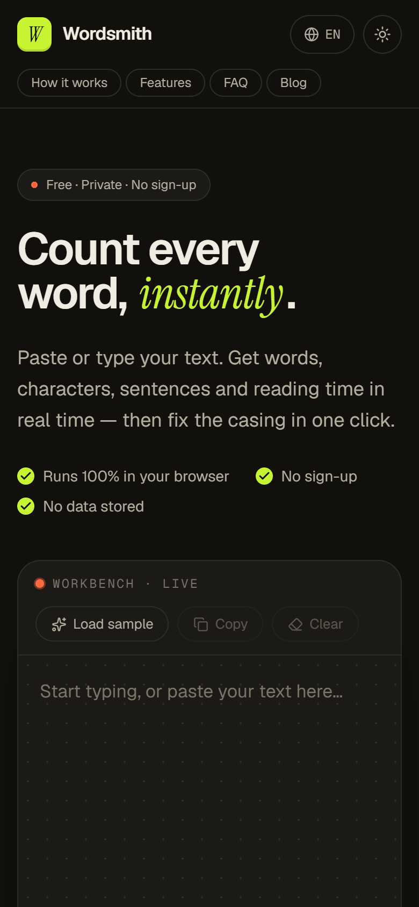

<div align="center">

# Site Template

**A lightweight Next.js starter for SEO tool sites: multilingual, fast, and ready for search and ads.**

Replace one tool, rewrite the copy, and launch. No database, accounts or backend.

[](https://github.com/cdt2019/site-template/actions/workflows/ci.yml)
[](LICENSE)


English · [简体中文](README.zh-CN.md)



</div>

> The screenshots show the included demo, **Wordsmith**, a browser-based word counter. Replace it with your own tool.

## Why this template

Small tool sites live or die on search traffic, and most of the setup is the same every time: localized routes, canonical and hreflang tags, a sitemap, structured data, legal pages, ad slots. This template has that done, so a new site is mostly one component and its copy.

- **One file to replace.** Your tool lives in `src/tool/`.
- **SEO from the first deploy.** Metadata, hreflang, JSON-LD, sitemap and social images are built in.
- **No servers to run.** No database, sign-in or API keys are needed.
- **Monetization ready.** AdSense and Google Analytics turn on with one environment variable each.

## Features

| Area | What you get |
| --- | --- |
| **Tool workspace** | A demo tool with pure, unit-tested logic, separate from its interface |
| **Landing page** | Hero, tool, how it works, features, FAQ and call to action |
| **Technical SEO** | Title, description, canonical, hreflang with `x-default`, sitemap, robots |
| **Structured data** | JSON-LD for WebApplication, FAQPage and BlogPosting |
| **Social sharing** | Generated Open Graph images and favicon |
| **Multilingual** | English and Chinese, typed dictionaries, clean URLs with no prefix for the default language |
| **Blog** | MDX posts per language with reading time |
| **Ads and analytics** | AdSense slots and GA4, off until configured |
| **Required pages** | About, privacy and terms. The privacy policy reflects which services are enabled |
| **Design** | Dark and light themes, responsive layouts, design tokens in one file |

## Screenshots

<table>
  <tr>
    <td width="50%"><br><sub><b>Tool workspace</b></sub></td>
    <td width="50%"><br><sub><b>Light theme</b></sub></td>
  </tr>
  <tr>
    <td><br><sub><b>Blog</b></sub></td>
    <td><br><sub><b>Article</b></sub></td>
  </tr>
  <tr>
    <td><br><sub><b>Chinese version</b></sub></td>
    <td align="center"><br><sub><b>Mobile</b></sub></td>
  </tr>
</table>

## Quick start

Requires **Node.js 22**.

```bash
git clone https://github.com/cdt2019/site-template.git
```

```bash
cd site-template
```

```bash
npm install
```

```bash
npm run dev
```

Open <http://localhost:3000>. No configuration is needed.

## Make it yours

1. Set the name, URL and email in `src/config/site.ts`.
2. Replace the tool in `src/tool/`.
3. Rewrite the copy in `src/i18n/dictionaries/`, with your target keyword in the title, hero and FAQ.
4. Change colors in `src/app/globals.css` and the logo in `src/components/Logo.tsx`.
5. Add articles to `src/content/blog/`.
6. Deploy and submit `/sitemap.xml` to Google Search Console.

The full walkthrough is in the [customization guide](docs/customization.md).

## Configuration

Copy `.env.example` to `.env.local`. All variables are optional in development.

| Variable | Purpose |
| --- | --- |
| `NEXT_PUBLIC_SITE_URL` | Your public URL, used for canonical links, the sitemap and social images. **Set this in production** |
| `NEXT_PUBLIC_ADSENSE_CLIENT` | AdSense publisher ID. Ads stay off when empty |
| `NEXT_PUBLIC_GA_ID` | Google Analytics 4 ID. Analytics stay off when empty |

The template has no cookie consent banner. If you enable ads or analytics for visitors in the EEA, UK or Switzerland, add a consent solution first.

## Project structure

```text
src/
├── config/site.ts     Brand, URL, languages, ads and analytics
├── tool/              Your tool: logic and interface
├── i18n/              English and Chinese copy
├── content/blog/      MDX articles
├── app/
│   ├── [lang]/        Home, blog, about, privacy, terms
│   ├── sitemap.ts     Sitemap with language alternates
│   ├── robots.ts      Robots rules
│   └── globals.css    Design tokens
├── components/        Header, footer, ads, JSON-LD and sections
├── lib/               SEO, localized paths, blog loader
└── proxy.ts           Language routing
tests/                 Unit tests
docs/                  Customization guide and screenshots
```

## Scripts

| Command | Purpose |
| --- | --- |
| `npm run dev` | Start the dev server |
| `npm run build` | Create a production build |
| `npm start` | Run the production build |
| `npm run lint` | Run ESLint |
| `npm run typecheck` | Check types |
| `npm test` | Run unit tests |

## Deploy

Works on **Vercel** or any **Node.js** host: run `npm run build`, then `npm start`. Set `NEXT_PUBLIC_SITE_URL` to your domain. See the [guide](docs/customization.md#deploy) for platform notes.

## Need accounts and payments?

| | Site Template | [AI SaaS Template](https://github.com/cdt2019/ai-saas-template) |
| --- | --- | --- |
| Best for | Free tools funded by ads | Paid AI products |
| Database | None | PostgreSQL |
| Sign-in | None | Email, Google, GitHub |
| Payments | None | Stripe, Creem, Waffo |
| Admin console | None | Included |

## Project status

This is a young project. Lint, type checks, unit tests and production builds run in CI, but the template hasn't yet been verified on each hosting platform or with live AdSense and Analytics accounts.

## Contributing

Issues and pull requests are welcome. Read [CONTRIBUTING.md](CONTRIBUTING.md) first, and report vulnerabilities privately as described in [SECURITY.md](SECURITY.md).

## License

[MIT](LICENSE). Use it for personal and commercial projects. You are responsible for your site's privacy, advertising and legal compliance.
