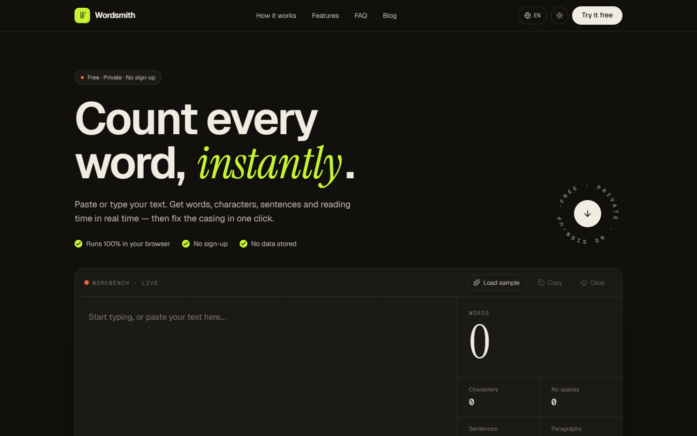
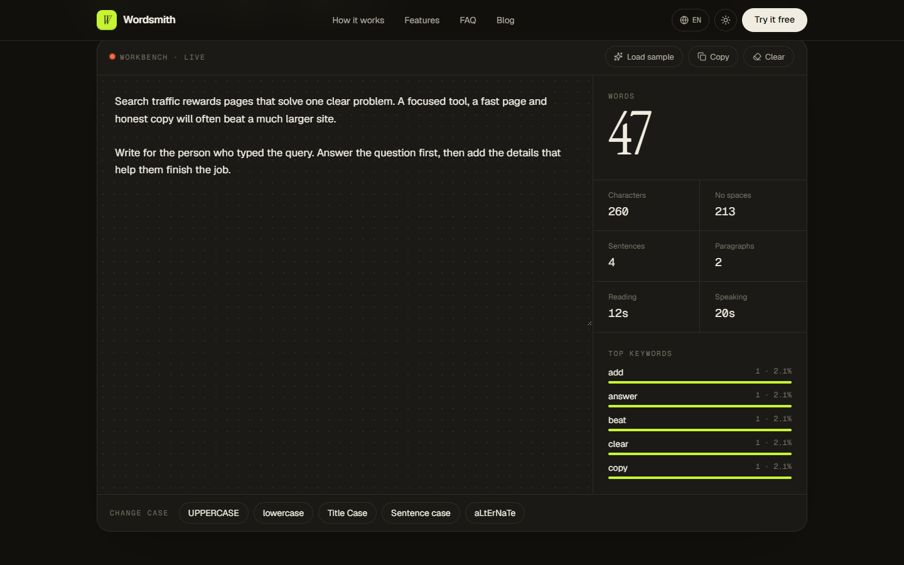
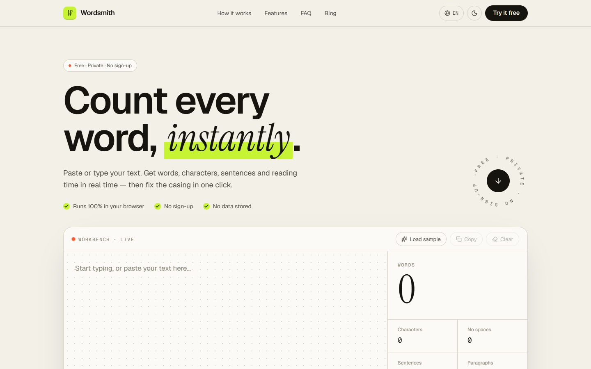
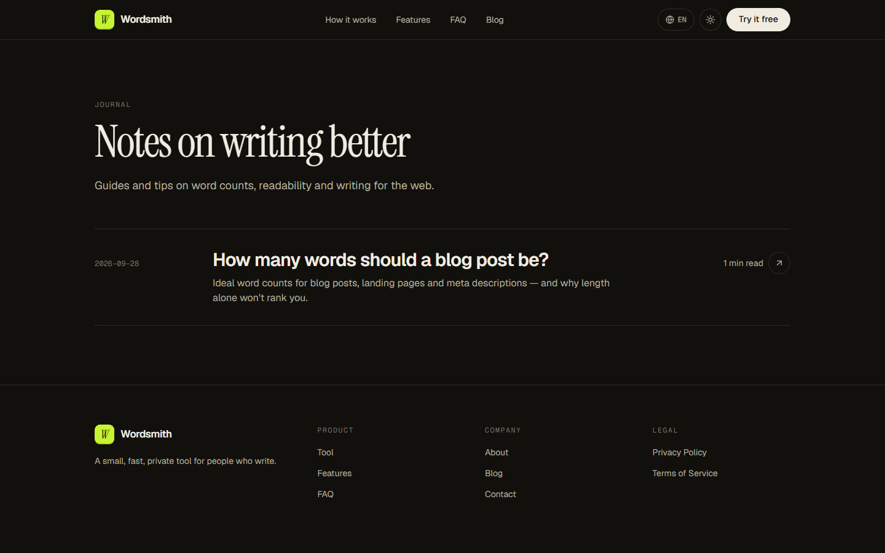
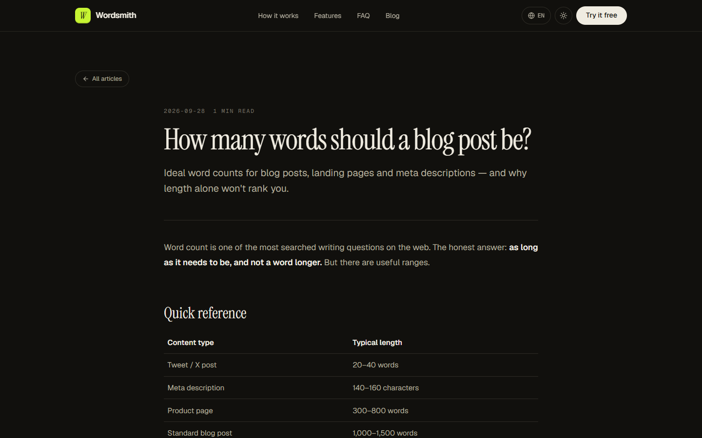
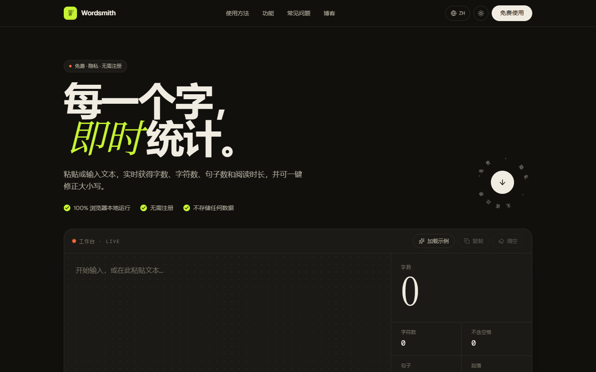
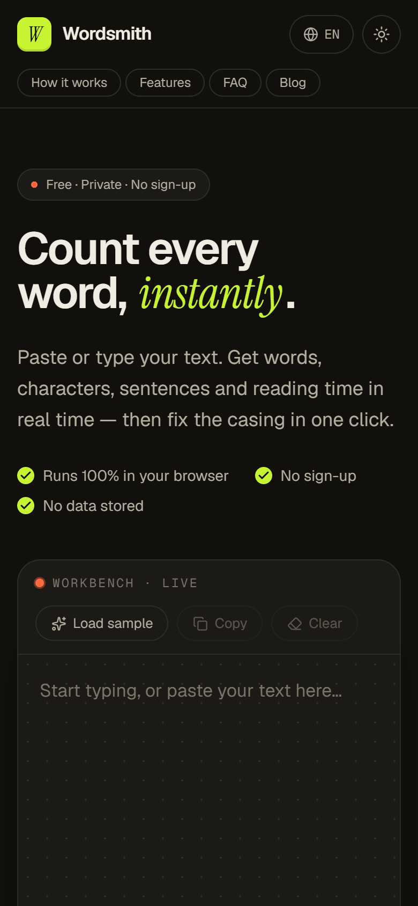

<div align="center">

# Site Template

**轻量的 Next.js 工具站开源模板：多语言、速度快，SEO 和广告都准备好了。**

换一个工具、改掉文案就能上线。不需要数据库、账号系统或后端。

[](https://github.com/cdt2019/site-template/actions/workflows/ci.yml)
[](LICENSE)


[English](README.md) · 简体中文



</div>

> 截图展示的是内置演示工具 **Wordsmith**（浏览器本地字数统计），换成你自己的工具即可。

## 为什么做这个模板

小工具站靠搜索流量，而每次建站的基础工作都差不多：多语言路由、canonical 和 hreflang、sitemap、结构化数据、法律页面、广告位。这些模板都做好了，新站基本只要写一个组件和文案。

- **只换一个地方。** 工具代码都在 `src/tool/`。
- **第一次部署就有 SEO。** 元数据、hreflang、JSON-LD、sitemap、社交分享图都内置了。
- **不用维护服务。** 不需要数据库、登录或 API Key。
- **随时能变现。** AdSense 和 Google Analytics 各配一个环境变量就开启。

## 功能

| 模块 | 内容 |
| --- | --- |
| **工具工作台** | 演示工具，逻辑是纯函数并带单元测试，和界面分离 |
| **落地页** | 首屏、工具、使用方法、功能、FAQ、行动号召 |
| **技术 SEO** | 标题、描述、canonical、带 `x-default` 的 hreflang、sitemap、robots |
| **结构化数据** | WebApplication、FAQPage、BlogPosting 的 JSON-LD |
| **社交分享** | 自动生成 Open Graph 图和 favicon |
| **多语言** | 中英文、带类型检查的字典，默认语言网址不带前缀 |
| **博客** | 按语言管理的 MDX 文章，带阅读时间 |
| **广告和统计** | AdSense 广告位和 GA4，配置后才开启 |
| **必备页面** | 关于、隐私政策、服务条款；隐私政策按实际开启的服务显示 |
| **设计** | 深浅色主题、响应式布局，设计变量集中在一个文件 |

## 功能截图

<table>
  <tr>
    <td width="50%"><br><sub><b>工具工作台</b></sub></td>
    <td width="50%"><br><sub><b>浅色主题</b></sub></td>
  </tr>
  <tr>
    <td><br><sub><b>博客</b></sub></td>
    <td><br><sub><b>文章页</b></sub></td>
  </tr>
  <tr>
    <td><br><sub><b>中文版</b></sub></td>
    <td align="center"><br><sub><b>手机端</b></sub></td>
  </tr>
</table>

## 快速开始

需要 **Node.js 22**。

```bash
git clone https://github.com/cdt2019/site-template.git
```

```bash
cd site-template
```

```bash
npm install
```

```bash
npm run dev
```

打开 <http://localhost:3000>，不需要任何配置。

## 改成你自己的站

1. 在 `src/config/site.ts` 改名称、域名和邮箱。
2. 替换 `src/tool/` 里的工具。
3. 改 `src/i18n/dictionaries/` 的文案，把目标关键词写进标题、首屏和 FAQ。
4. 在 `src/app/globals.css` 改颜色，在 `src/components/Logo.tsx` 改 Logo。
5. 在 `src/content/blog/` 写文章。
6. 部署后到 Google Search Console 提交 `/sitemap.xml`。

完整步骤见[改造指南](docs/customization.zh-CN.md)。

## 配置

把 `.env.example` 复制成 `.env.local`。开发环境下所有变量都是可选的。

| 变量 | 作用 |
| --- | --- |
| `NEXT_PUBLIC_SITE_URL` | 站点地址，用于 canonical、sitemap 和分享图。**线上必须设置** |
| `NEXT_PUBLIC_ADSENSE_CLIENT` | AdSense 发布商 ID，留空不加载广告 |
| `NEXT_PUBLIC_GA_ID` | Google Analytics 4 ID，留空不加载统计 |

模板没有 Cookie 同意弹窗。如果要对欧洲经济区、英国或瑞士的访客开启广告或统计，请先接入同意方案。

## 目录结构

```text
src/
├── config/site.ts     品牌、域名、语言、广告和统计
├── tool/              你的工具：逻辑和界面
├── i18n/              中英文文案
├── content/blog/      MDX 文章
├── app/
│   ├── [lang]/        首页、博客、关于、隐私、条款
│   ├── sitemap.ts     带语言互链的 sitemap
│   ├── robots.ts      robots 规则
│   └── globals.css    设计变量
├── components/        页头、页脚、广告、JSON-LD、页面板块
├── lib/               SEO、多语言路径、博客加载
└── proxy.ts           语言路由
tests/                 单元测试
docs/                  改造指南和截图
```

## 常用命令

| 命令 | 作用 |
| --- | --- |
| `npm run dev` | 启动开发服务器 |
| `npm run build` | 生产构建 |
| `npm start` | 运行生产构建 |
| `npm run lint` | 运行 ESLint |
| `npm run typecheck` | 类型检查 |
| `npm test` | 运行单元测试 |

## 部署

可以部署到 **Vercel** 或任意 **Node.js** 服务器：运行 `npm run build`，再运行 `npm start`。记得把 `NEXT_PUBLIC_SITE_URL` 设成你的域名。各平台说明见[指南](docs/customization.zh-CN.md#部署)。

## 需要登录和付费？

| | Site Template | [AI SaaS Template](https://github.com/cdt2019/ai-saas-template) |
| --- | --- | --- |
| 适合 | 靠广告变现的免费工具 | 付费 AI 产品 |
| 数据库 | 无 | PostgreSQL |
| 登录 | 无 | 邮箱、Google、GitHub |
| 支付 | 无 | Stripe、Creem、Waffo |
| 管理后台 | 无 | 有 |

## 项目状态

这是一个刚开源的项目。CI 会跑 lint、类型检查、单元测试和生产构建，但还没有在各个托管平台上逐一验证，也没有接过真实的 AdSense 和 Analytics 账号。

## 参与贡献

欢迎提 Issue 和 PR，请先读 [CONTRIBUTING.md](CONTRIBUTING.md)。安全问题请按 [SECURITY.md](SECURITY.md) 私下报告。

## 许可证

[MIT](LICENSE)，个人和商业项目都可以使用。网站的隐私、广告和法律合规由使用者自行负责。
